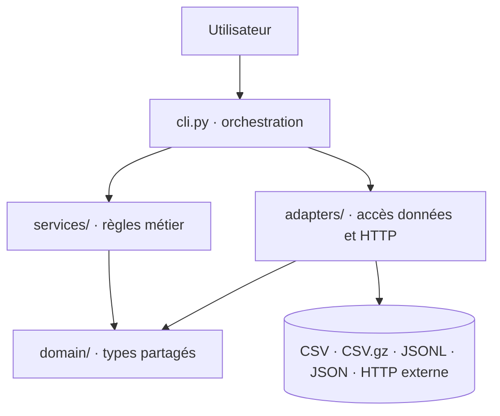

# Architecture Mobilis — décision de structure

**Statut :** architecture cible préparée (squelette uniquement, sans logique métier).  
**Référence :** T-03, [issue #8](https://github.com/abidiDev/mobilis-python-avance/issues/8).  
**Python :** 3.11+ ; paquet installable `src/mobilis`.

## Choix

**Monolithe modulaire en trois couches, avec un domaine commun et des dépendances dirigées vers ce domaine.**

C'est une bibliothèque Python exécutée par une interface en ligne de commande (**CLI**) ; nous ne construisons ni serveur REST ni microservices. Le simulateur de bornes est un service HTTP **externe consommé** par Mobilis.

- **Présentation — `cli.py`** : analyse les arguments, choisit les fichiers et orchestre les appels ; ne contient pas de règles métier.
- **Métier — `services/`** : validation des stations, statistiques de fréquentation, tarification et comparaison des états. Fonctions pures autant que possible ; aucune lecture directe de CSV ou d'appel HTTP dans les règles métier.
- **Infrastructure — `adapters/`** : lecture des CSV/CSV.gz/JSONL/JSON et client HTTP avec gestion des erreurs ; convertit les formats externes en objets métier.
- **Domaine — `domain/`** : modèles partagés, énumérations et diagnostics d'anomalies. Ne dépend ni des services, ni des adaptateurs, ni de la CLI.

### Dépendances autorisées



La CLI **compose** les adaptateurs et services : elle transmet les objets produits par les adaptateurs aux fonctions métier. Les services ne doivent pas importer les adaptateurs ; les adaptateurs ne doivent pas importer les services.

## Organisation cible

Les répertoires `domain/`, `services/` et `adapters/` sont créés dans cette branche. Les noms des modules métier ci-dessous sont **prévus**, non encore implémentés.

```text
src/mobilis/
├── __init__.py
├── cli.py                       # point d'entrée futur ; non implémenté
├── domain/
│   ├── __init__.py
│   ├── models.py                # prévu : Station, Trajet, Abonnement, rapports
│   └── anomalies.py             # prévu : diagnostics partagés
├── services/
│   ├── __init__.py
│   ├── stations.py              # prévu : validation et référentiel
│   ├── frequentation.py         # prévu : agrégations des trajets
│   ├── facturation.py           # prévu : règles R1–R12, Decimal
│   └── etat_reseau.py           # prévu : comparaison réel / référentiel
└── adapters/
    ├── __init__.py
    ├── stations_csv.py          # prévu : lecture et normalisation CSV
    ├── trajets_csv.py           # prévu : générateur sur CSV.gz
    ├── abonnes_jsonl.py         # prévu : historique des abonnements
    ├── tarifs_json.py           # prévu : grilles de prix
    └── bornes_http.py           # prévu : client HTTP, retry et concurrence
```

Chaque cas aura ses tests `tests/test_*.py`, ajoutés avec le code métier dans les tickets correspondants. Les données brutes du kit restent **hors du dépôt Git**.

## Responsabilités et communication

| Besoin | Adaptateur | Service | Résultat |
|---|---|---|---|
| `mobilis stations` | `stations_csv` | `stations` | Stations validées et anomalies |
| `mobilis frequentation` | `trajets_csv` | `frequentation` | Statistiques par station, période et heure |
| `mobilis facturation` | `trajets_csv`, `abonnes_jsonl`, `tarifs_json` | `facturation` | Recettes mensuelles, par formule |
| `mobilis etat` | `stations_csv`, `bornes_http` | `stations`, `etat_reseau` | Bornes vides/pleines et incohérences |

### Scénario : facturation

1. La CLI reçoit `mobilis facturation` et les chemins configurables.
2. `trajets_csv` fournit progressivement un flux d'objets `Trajet` (`Iterator[Trajet]`).
3. `abonnes_jsonl` fournit l'historique d'abonnements ; `tarifs_json` fournit les grilles applicables.
4. `facturation` reçoit **des objets Python, pas des chemins de fichiers** ; elle applique les règles métier et calcule avec `Decimal`.
5. La CLI affiche le rapport retourné par le service.

### Scénario : état des stations

1. La CLI charge le référentiel via `stations_csv`, puis le valide via `stations`.
2. `bornes_http` interroge le simulateur des bornes ; son client respecte la limite de 8 requêtes simultanées.
3. `etat_reseau` compare les états HTTP aux stations valides, détecte les écarts et produit un rapport.
4. La CLI affiche le résultat. Le module API est donc un **client sortant**, pas un contrôleur REST.

## Contrats communs à confirmer avec le binôme (T-03)

- Les identifiants de station sont conservés sous forme de `str`, par exemple `"MB-0033"`.
- Les instants sont représentés par des `datetime` avec fuseau ; UTC pour les échanges, Europe/Paris pour les statistiques locales.
- Les montants utilisent `Decimal` et non `float`.
- Les anomalies utilisent un modèle commun (source, ligne si disponible, catégorie, valeur, traitement).
- Les lecteurs de trajets exposent un `Iterator[Trajet]`, sans charger tout le fichier en RAM.
- Les services acceptent des modèles ou des itérables déjà normalisés.
- La politique de résolution des stations répétées et les règles exactes R1–R12 restent à valider sur la spécification officielle ; **ne pas les supposer**.
- Les noms et signatures définitifs seront consignés dans `docs/decisions.md` à l'issue de T-03.

## Répartition et tickets

- **A :** Stations (#9–#11), API (#17–#18), intégration CLI/livraison (#19–#21).
- **B :** Trajets (#12–#13), Abonnements et facturation (#14–#16).
- **Commun :** validation des contrats (#8), revue croisée et tests.

## Portée de ce commit

Ce commit crée **uniquement la structure des packages** et la documentation de l'architecture. Il n'implémente pas les modèles, services, adaptateurs ni la commande `mobilis`. Les fonctionnalités viendront dans les PR de chaque ticket. Le ticket #8 ne doit pas être fermé par ce commit tant que le binôme n'a pas validé les contrats et le journal des anomalies.
